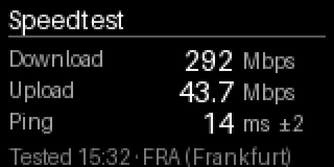

<div align="center">

# 📶 BUSY Speedtest

### *A simple internet speed test for the BUSY Bar*




</div>

---

## ✨ What it does

Tests your **ping**, **download** and **upload** speed, and shows the results. Nothing fancy:
just the numbers.

| Screen | What you see |
| :-- | :-- |
| **Front** (72×16 RGB LEDs) | While testing, the live speed and a progress line along the bottom. Afterwards, **download** (blue), **upload** (orange) and **ping** (green) take turns, 4 seconds each |
| **Back** (160×80, 16 greys) | All three results at once, with the jitter, when it was tested, and which server answered |

It tests when it starts, then **every 60 minutes** (change it with `--every`), and the bar's
light blinks blue when a new result is in.

The test runs against [Cloudflare's speed test](https://speed.cloudflare.com) servers, picking
the one closest to you: a dozen tiny requests for the ping, then 8 seconds each of download and
upload over 4 connections at once. The first second of each is left out, while the connections
get up to speed.

## 🎮 Controls

| Press | Does |
| :-- | :-- |
| **OK** | Test again now |
| **Back** | Show the next reading |

## 🚀 Run it

You need Python 3.10+ with [Pillow](https://pypi.org/project/pillow/), and the official
[busylib](https://pypi.org/project/busylib/) for the buttons.

```bash
pip install pillow busylib
```

```bash
python bar_speedtest.py
```

Just want a quick test in the terminal, without the bar? That needs nothing but Python:

```bash
python bar_speedtest.py --no-bar
```

| Option | Does |
| :-- | :-- |
| `--every 15` | Minutes between automatic tests (default 60; `0` = only when you press OK) |
| `--seconds 5` | How long the download and upload parts each take (default 8) |
| `--server URL` | Another server that speaks Cloudflare's `/__down` and `/__up` |
| `--host 192.168.1.50` | The bar's Wi-Fi address (default `10.0.4.20`, over USB) |
| `--token KEY` | The bar's API key, if HTTP access is set to key mode (or set `BUSYBAR_TOKEN`) |
| `--priority 30` | Draw priority, 1–100 (default 30) |

## 🔁 Start at login (Linux)

```bash
python bar_speedtest.py --install
```

It remembers the options you give with it (like `--every 30`). Stop it with:

```bash
python bar_speedtest.py --uninstall
```

## 📁 Files

| File | What's in it |
| :-- | :-- |
| `bar_speedtest.py` | The app: runs the tests, draws on the bar, answers the buttons |
| `tester.py` | The speed test itself (standard library only) |
| `art.py` | What the two screens look like |
