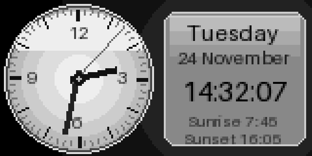
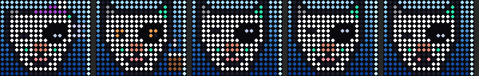

<div align="center">

# 🕰️ Luca Aero Clock 🐺

### *A glossy Frutiger Aero desk clock for the BUSY Bar, with a sky that follows the real day*




</div>

---

## ✨ What it does

| Screen | What you see |
| :-- | :-- |
| **Front** (72×16 RGB LEDs) | The time in **big glossy digits** (the colon blinks with the seconds) over the **real sky right now**: stars and the moon in **tonight's actual phase**, a violet dawn, the sun climbing and crossing the sky, a golden sunset, then dusk. Every 30 seconds the **date** takes a turn |
| **Back** (160×80, 16 greys) | A **Windows 7 clock gadget**: a round glass clock face with hour, minute and second hands, plus a panel with the weekday, date, digital time, and today's **sunrise and sunset** |

### 🐺 Luca through the day



| When | Luca |
| :-- | :-- |
| 23:00–06:00 | 😴 Asleep in a purple **nightcap**, with a little *z* |
| 06:00–10:00 | ☕ Sipping **coffee** (it steams) |
| Daytime | 😊 **Sunny** and happy |
| Evening | 🥰 **Cozy** |
| On the hour, 08:00–21:00 | 🐺 A short **howl**, and the bar's light glows gold |

## 🎮 Controls

| Press | Does |
| :-- | :-- |
| **OK** | Show the date |
| **Start** | Luca howls |
| **Back** | Switch between 24-hour and 12-hour time |

## 🌍 The real sun and moon

The sky is worked out on your PC, with no internet needed: the sun's height for your
location at this minute, today's sunrise and sunset, and the moon's phase. For your location
the clock uses, in order:

1. `--lat` and `--lon`, if you give them
2. the place you set up in [⛅ Luca Weather Den](../luca-weather-den/), if you have
3. otherwise a guess from your time zone, which gets the rough rhythm of the day right

## 🚀 Run it

You need Python 3.10+ with [Pillow](https://pypi.org/project/pillow/) and the official
[busylib](https://pypi.org/project/busylib/) for the buttons.

```bash
pip install pillow busylib
```

```bash
python aero_clock.py
```

| Option | Does |
| :-- | :-- |
| `--lat 52.52 --lon 13.41` | Your location, for the sun's real path |
| `--12h` | 12-hour time |
| `--no-chime` | No howl on the hour |
| `--host` / `--token` | The bar's address over Wi-Fi, and its API key if HTTP access is set to *key* mode |
| `--priority` | Draw priority 1–100 (default 10) |

## 🐧 Start automatically at login (Linux)

```bash
~/.venvs/luca/bin/pip install pillow busylib
```

```bash
~/.venvs/luca/bin/python aero_clock.py --install
```

Add `--lat`/`--lon`, `--12h` or `--no-chime` if you use them; they're saved into the service.

| To… | Run |
| :-- | :-- |
| See what Luca is doing | `journalctl --user -u luca-aero-clock -f` |
| Restart him (after changing the code) | `systemctl --user restart luca-aero-clock` |
| Stop starting at login | `~/.venvs/luca/bin/python aero_clock.py --uninstall` |

## 🤝 With the other apps

The clock has the **lowest priority** (10), so it's what you see when nothing else has
anything to show. It's the bar's "home screen":

| App | Priority |
| :-- | :-- |
| 🔔 Notify Den | 70 |
| 🌕 Pack Focus | 60 |
| 🎵 Now Playing | 50 |
| 📈 PC Stats | 20 |
| ⛅ Weather Den | 15 |
| 🕰️ **Aero Clock** | **10** |

PC Stats and Weather Den are "always on" too, so with either running, the clock stays
behind them. Run the clock on its own as your home screen, or give it a higher `--priority`.

> 🏠 Running more than one always-on app (PC Stats, Weather Den, Aero Clock)? Start
> [Luca's Den](../luca-den/) and they'll take turns, a minute each.

## 🎨 Make it yours

- `art.py`: the sky colors for each sun height in `SKY_STOPS`, Luca's moods in `luca()`, and
  `mood_for()` (which mood when), the date page and the clock gadget
- `aero_clock.py`: `CHIME_HOURS`, `DATE_EVERY` and `DATE_FOR`
- `sky.py`: the sun and moon maths
- `python art.py` redraws the previews in `preview/`

## 🔧 How it works

The big digits and Luca's moods are uploaded **once**. The sky and the date are redrawn
once a minute, and the gadget once a second for the second hand. Each frame just places the
digits, so the time ticks without uploading anything for the front strip. The bar code
shared by all the apps lives in [`../shared/`](../shared/).

## 💖 Credits

Luca Wood portrait art by **KiroHusky**, which his pixel sprite is based on.
