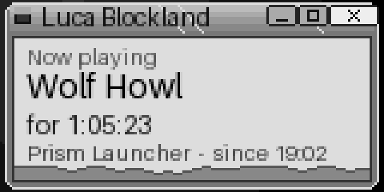

<div align="center">

# ⛏️ Luca Blockland 🐺

### *When your Minecraft instance starts, Luca grabs a pickaxe beside a blocky landscape on the BUSY Bar*




</div>

---

## ✨ What it does

| Screen | What you see |
| :-- | :-- |
| **Front** (72×16 RGB LEDs) | Luca with a pickaxe on a leafy glass tile, beside a blocky landscape that scrolls by: grassy hills, dirt, stone, little trees and a pond. By day there's a square sun and drifting square clouds; at night (7 pm to 7 am), stars and a square moon. The pages take turns: your **instance's name**, a moment of **just the scenery**, **how long you've played**, the scenery again |
| **Back** (160×80, 16 greys) | A Windows 7-style **Luca Blockland** window: the instance, the time played, the launcher and when you started |

It comes up by itself the moment your instance starts. The LED blinks green and Luca cheers ^^.
When you close the game, he steps aside. The art is original pixel art in this repo's
Frutiger Aero style.

## 🎮 Controls

| Press | Does |
| :-- | :-- |
| **Start** / **Back** / **Wheel** | Next / previous page |
| **OK** | Hide Luca until the next time you start the game |

## 🚀 Run it

You need Python 3.10+ with [Pillow](https://pypi.org/project/pillow/) and the official
[busylib](https://pypi.org/project/busylib/) for the buttons.

```bash
pip install pillow busylib
```

It watches for an instance called **Wolf Howl** by default:

```bash
python blockland.py
```

Another instance, or any Minecraft at all:

```bash
python blockland.py --instance "My World"
```

```bash
python blockland.py --instance "*"
```

Try it without starting the game:

```bash
python blockland.py --demo
```

| Option | Does |
| :-- | :-- |
| `--instance NAME` | Which instance to watch for (default `Wolf Howl`; `*` for any). Capitals don't matter |
| `--host` / `--token` | The bar's address over Wi-Fi, and its API key if HTTP access is set to *key* mode |
| `--priority` | Draw priority 1–100 (default 55) |
| `--fps` | Animation speed (default 4) |

### 🧭 Which launchers?

Luca looks at your running programs (nothing is sent anywhere) for the game's Java
process, and finds the instance's name in its folder:

| Launcher | Works because the instance lives in… |
| :-- | :-- |
| Prism Launcher, PolyMC, MultiMC | `…/instances/Wolf Howl/minecraft` |
| ATLauncher, GDLauncher | `…/instances/Wolf Howl` |
| CurseForge, Modrinth app | `…/Instances/Wolf Howl` (or the profile's folder) |
| The official launcher | Give the profile its own **game directory** named after it, like `~/.minecraft-wolf-howl`… or just use `--instance "*"` |

## 🐧 Start automatically at login (Linux)

From the repo's main folder, `python install.py blockland` asks for your instance's name
once and remembers it. Or by hand, using Luca's Python environment:

```bash
~/.venvs/luca/bin/pip install pillow busylib
```

```bash
~/.venvs/luca/bin/python blockland.py --install
```

| To… | Run |
| :-- | :-- |
| See what Luca is doing | `journalctl --user -u luca-blockland -f` |
| Restart him (after changing the code) | `systemctl --user restart luca-blockland` |
| Stop starting at login | `~/.venvs/luca/bin/python blockland.py --uninstall` |

## 🤝 With the other apps

| App | Priority |
| :-- | :-- |
| 🔔 Notify Den / 💬 Discord messages | 70 |
| 🔴 On Air | 65 |
| 🌕 Pack Focus | 60 |
| ⛏️ **Blockland** | **55** |
| 🎵 Now Playing | 50 |
| 🏠 Den, 📈 PC Stats, ⛅ Weather, 🕰️ Clock | 25 and below |

So while you play, Luca stays over your music and the always-on apps, and notifications,
calls and going live still pop up over him.

## 🎨 Make it yours

- `art.py`: the landscape in `scene()` (colors at the top, trees in `TREES`, the pond in
  `POND`), Luca and his pickaxe in `LUCA` / `PICK_UP` / `PICK_DOWN`, and the window in
  `back_screen()`
- `blockland.py`: the page order and timing in `PAGES` / `PAGE_SECONDS`, and daytime in `DAY_HOURS`
- `python art.py` redraws the previews in `preview/`

## 🔧 How it works

`sources.py` checks your processes every 3 seconds. Luca's tiles and the 48 landscape
frames for the current time of day are uploaded to the bar once. After that, each frame
just says which pictures go where. The text line is sent one screen-sized piece at a
time, since the bar won't take a picture wider than its screen. The bar code shared by
all the apps lives in [`../shared/`](../shared/).

## 💖 Credits

Luca Wood portrait art by **KiroHusky**, which his pixel sprite is based on. Minecraft is a
trademark of Mojang; this is a fan-made companion app, not affiliated with them.
