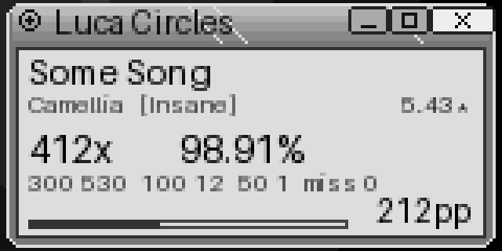
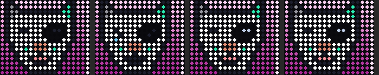

<div align="center">

# 🎯 Luca Circles 🐺

### *For when you're clicking circles in osu!: your live combo and accuracy on the BUSY Bar, with Luca cheering you on*

_<; the results screen turns gold with S 98.60% and Luca cheering" width="720">





</div>

---

## ✨ What it does

| When | Front (72×16 RGB LEDs) |
| :-- | :-- |
| **Playing** | A focused Luca beside your **combo** (white) and **accuracy** (pink), rings rippling across a violet-to-magenta background, and a line along the bottom showing how far through the song you are |
| **A miss or combo break** | The background flashes **red** and Luca goes >_< |
| **Results** | It turns **gold** with your **rank and accuracy**. Luca cheers for an S or SS, and the LED glows gold |
| **Song select / menus** | The song you've picked scrolls by on lavender |

The **back screen** (160×80, 16 greys) is a Windows 7-style **Luca Circles** window: the song,
artist, difficulty and stars, then your combo, accuracy, 300/100/50/miss counts and pp.

Luca appears when osu! opens and steps aside when it closes. All the art is original
pixel art in this repo's Frutiger Aero style.

## 📡 Live stats with tosu

osu! doesn't share what's happening in a game, so the live numbers come from
**[tosu](https://github.com/tosuapp/tosu)**: a free, open-source helper that reads osu!
(**stable** through Wine, and **lazer**) and serves it on your own PC at
`http://127.0.0.1:24050`. Luca only reads from it, and nothing leaves your PC.

1. Download tosu for Linux from its [releases page](https://github.com/tosuapp/tosu/releases)
   and run it alongside osu! (its README covers Wine and lazer setups).
2. That's it: Luca finds it by himself.

**Without tosu**, Luca still shows up while osu! is open (on lavender, saying OSU!), just
without the live numbers.

## 🎮 Controls

| Press | Does |
| :-- | :-- |
| **OK** | Hide Luca until you next open osu! |

## 🚀 Run it

You need Python 3.10+ with [Pillow](https://pypi.org/project/pillow/) and the official
[busylib](https://pypi.org/project/busylib/) for the buttons.

```bash
pip install pillow busylib
```

```bash
python circles.py
```

See it all without opening osu! (pick a song, play it with a miss, get an S):

```bash
python circles.py --demo
```

| Option | Does |
| :-- | :-- |
| `--tosu HOST:PORT` | Where tosu serves (default `127.0.0.1:24050`) |
| `--host` / `--token` | The bar's address over Wi-Fi, and its API key if HTTP access is set to *key* mode |
| `--priority` | Draw priority 1–100 (default 57) |
| `--fps` | Animation speed (default 8) |

## 🐧 Start automatically at login (Linux)

From the repo's main folder, `python install.py circles` sets it up. Or by hand, using
Luca's Python environment:

```bash
~/.venvs/luca/bin/pip install pillow busylib
```

```bash
~/.venvs/luca/bin/python circles.py --install
```

| To… | Run |
| :-- | :-- |
| See what Luca is doing | `journalctl --user -u luca-circles -f` |
| Restart him (after changing the code) | `systemctl --user restart luca-circles` |
| Stop starting at login | `~/.venvs/luca/bin/python circles.py --uninstall` |

## 🤝 With the other apps

| App | Priority |
| :-- | :-- |
| 🔔 Notify Den / 💬 Discord messages | 70 |
| 🔴 On Air | 65 |
| 🌕 Pack Focus | 60 |
| 🎯 **Circles** | **57** |
| ⛏️ Blockland | 55 |
| 🎵 Now Playing | 50 |

So while osu! is open, Luca stays over your music and everything always-on. Notifications,
calls and going live still pop up over him (try Discord's or your desktop's do-not-disturb
while you play).

## 🎨 Make it yours

- `art.py`: the background colors in `MOODS`, the rings in `RINGS`, Luca's poses in `luca()`,
  the number colors in `COLORS`, and the window in `back_screen()`
- `circles.py`: how long a miss flashes (`MISS_SECONDS`) and the cheer lasts (`CHEER_SECONDS`)
- `python art.py` redraws the previews in `preview/`

## 🔧 How it works

`sources.py` asks tosu for the latest 8 times a second (it reads both of tosu's JSON
shapes, `/json/v2` and the older `/json`), and looks for the osu! process every 3 seconds.
The digits, backgrounds and Luca are uploaded to the bar once, so a changing combo is just a
new arrangement of pictures that are already there. The bar code shared by all the apps
lives in [`../shared/`](../shared/).

## 💖 Credits

Luca Wood portrait art by **KiroHusky**, which his pixel sprite is based on. osu! is
ppy's game; this is a fan-made companion app, not affiliated with it. Live data by
[tosu](https://github.com/tosuapp/tosu).
