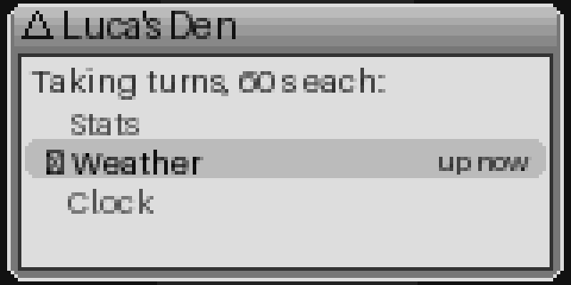

<div align="center">

# 🏠 Luca's Den 🐺

### *Home base for all your Luca apps: the always-on ones take turns, and you can check on everything at once*




</div>

---

## ✨ What it does

**PC Stats**, **Weather Den** and **Aero Clock** all want the bar all the time. On their
own, the one with the highest priority always wins and the others never show. Luca's Den
makes them **take turns**:

- Each gets the bar for **a minute** (`--seconds`), in order.
- Between turns, a glossy **channel-switch card** slides in (*STATS*, *WEATHER*, *CLOCK*) while
  Luca waves you over, and the back screen shows the line-up.
- Apps that only show up when something happens still jump in over the top whenever they need
  to: 🎵 music, 🔔 notifications, 💬 Discord, 🌕 focus rounds, 🔴 ON AIR and 💜 chat.
- Only apps that are **running** take part. Don't want the weather? Don't run Weather Den. If
  just one is running, it simply stays on.
- Stop the Den and everything instantly goes back to normal.

## 🔍 Check on everything

```bash
python luca_den.py --status
```

```
  App               Start at login  Service  Shows                         Priority
  ----------------  --------------  -------  ----------------------------  --------
  luca-now-playing  yes             active   when music plays              50
  luca-pc-stats     yes             active   always (takes turns)          20
  luca-notify-den   yes             active   on a notification             70
  …
```

It lists every Luca app, whether it's set to start at login, whether it's running right now,
when it shows, and its priority.

## 🚀 Run it

You need Python 3.10+ with [Pillow](https://pypi.org/project/pillow/).

```bash
python luca_den.py
```

| Option | Does |
| :-- | :-- |
| `--apps clock,weather` | Which apps take turns, in order (any of `stats`, `weather`, `clock`) |
| `--seconds 120` | How long each turn lasts (default 60) |
| `--status` | List every Luca app and whether it's running |
| `--host` / `--token` | The bar's address over Wi-Fi, and its API key if HTTP access is set to *key* mode |

## 🐧 Start automatically at login

```bash
~/.venvs/luca/bin/python luca_den.py --install
```

Add `--apps` or `--seconds` if you like; they're saved into the service. To stop starting at
login, run it again with `--uninstall`.

## 🔧 How it works

Every second the Den writes whose turn it is to `$XDG_RUNTIME_DIR/luca-bar/turn.json`. PC
Stats, Weather Den and Aero Clock read it (`shared/turns.py`) and step aside when it's not
their turn. If the Den stops updating it, they ignore it after a few seconds. Apps say
they're running with a small heartbeat file, which is also how `--status` knows.
