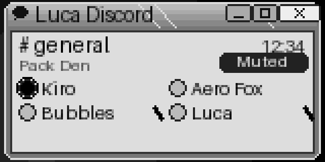

<div align="center">

# 💬 Luca Discord 🐺

### *Your Discord on the BUSY Bar in glossy blurple Aero: calls, who's talking, and new messages*




</div>

---

## ✨ What it does

| When | On the bar |
| :-- | :-- |
| 🎧 **You're in a voice call** | A glowing blurple panel takes turns showing the **channel** (`#HANGOUT`), the **server**, **how long you've been in**, and **how many are here**. Whenever someone talks, **their name** shows with **green sound waves**. Luca wears a headset, and **his mouth moves when you talk** |
| 🔇 **You're muted / deafened** | A red crossed-out **mic** (or **headset**) sits on the right, and Luca's mic light turns red |
| 💬 **A new message** (DM, mention, server message) | It pops up and scrolls by: the **author** in soft blurple, then the message. Luca's ears perk up with a **!** and the bar's light glows blurple |
| 😴 **Nothing going on** | Luca steps aside and the bar shows your other apps |

The **back screen** is **Luca Discord**, a Windows 7-style window. In a call it shows the
channel, server and time, with **everyone in the call** (whoever's talking gets a dark
"talking" ring, and muted people a slash). Otherwise it lists your latest messages.


## 🎮 Controls

| Press | In a call | With a message showing |
| :-- | :-- | :-- |
| **OK** | **Mute / unmute yourself** (rich mode) | Dismiss (and clear the queue) |
| **Start** / **Back** / **wheel** | Next / previous page | Next message |

Messages wait (and show later) while you're in a [🌕 Pack Focus](../luca-pack-focus/) round,
live or recording with [🔴 On Air](../luca-on-air/), or with the bar's selector on **OFF**.

## 🌈 Two modes

| | **Basic mode** (no setup) | **Rich mode** (one-time setup, recommended) |
| :-- | :-- | :-- |
| In a call | ✅ while Discord is using your mic, plus the call timer | ✅ channel, server, timer, member count |
| Who's talking | | ✅ live, with their name |
| Muted / deafened | | ✅ and **OK** mutes you |
| Messages | ✅ from your desktop notifications | ✅ straight from Discord |

Rich mode uses **Discord's own local RPC**, the official way apps on your PC talk to the
Discord desktop app. There are **no user tokens and no self-botting**, which would break
Discord's rules. If rich mode can't connect (Discord closed, not set up), Luca quietly uses
basic mode until it can.

### 🔧 Setting up rich mode (about 2 minutes)

1. Go to the [Discord Developer Portal](https://discord.com/developers/applications) and click
   **New Application**. Name it anything, like *Luca BUSY Bar*.
2. Open **OAuth2**. Copy the **Client ID**, then click **Reset Secret** and copy the **Client Secret**.
3. Still in **OAuth2**, under **Redirects**, add `http://localhost` and **Save Changes**.
4. Run Luca once by hand, with Discord open:

   ```bash
   python luca_discord.py --client-id YOUR_CLIENT_ID --client-secret YOUR_CLIENT_SECRET
   ```

   Discord pops up an **Authorize** window. Click **Authorize**. That's it: the login is saved
   in `~/.config/luca-discord/token.json` (only you can read it) and refreshes by itself, so
   you won't be asked again.

> Discord calls its RPC API a "private beta", but it works for the application's owner (you),
> and that's all Luca needs. It works with the official Discord desktop app (including Flatpak
> and Snap). Clients like Vesktop don't offer rich RPC, but basic mode works with them.

## 🚀 Run it

Linux, with Python 3.10+, [Pillow](https://pypi.org/project/pillow/), [dbus-fast](https://pypi.org/project/dbus-fast/)
(for desktop notifications) and the official [busylib](https://pypi.org/project/busylib/) (for the buttons).
Basic mode's call detection uses `pactl` (from `libpulse`, which comes with PipeWire's `pipewire-pulse` on Arch).

```bash
pip install pillow dbus-fast busylib
```

```bash
python luca_discord.py --demo
```

| Option | Does |
| :-- | :-- |
| `--client-id` / `--client-secret` | Rich mode (or set `DISCORD_CLIENT_ID` / `DISCORD_CLIENT_SECRET`) |
| `--basic` | Use basic mode even if rich mode is set up |
| `--private` | Never show what messages say: just who they're from |
| `--show 5` | Show each message at least this long (default 7 seconds, at most 15) |
| `--host` / `--token` | The bar's address over Wi-Fi, and its API key if HTTP access is set to *key* mode |
| `--priority-voice` / `--priority-message` | Draw priorities (defaults 64 and 70) |

## 🐧 Start automatically at login

Do the one-time **Authorize** by hand first (step 4 above). Then:

```bash
~/.venvs/luca/bin/pip install pillow dbus-fast busylib
```

```bash
~/.venvs/luca/bin/python luca_discord.py --client-id YOUR_CLIENT_ID --client-secret YOUR_CLIENT_SECRET --install
```

Your Client ID and Secret are saved into the service file, which only you can read (like the
bar's API key).

| To… | Run |
| :-- | :-- |
| See what Luca is doing | `journalctl --user -u luca-discord -f` |
| Restart him (after changing the code) | `systemctl --user restart luca-discord` |
| Stop starting at login | `~/.venvs/luca/bin/python luca_discord.py --uninstall` |

## 🤝 With the other apps

While Luca Discord runs, the other apps **hand Discord over to it**, so nothing shows twice:

- [🔔 Notify Den](../luca-notify-den/) skips Discord's notifications (and keeps showing everyone else's)
- [🔴 On Air](../luca-on-air/) doesn't light **IN CALL** for Discord calls (but still does for Zoom, Teams and others)

| App | Priority |
| :-- | :-- |
| 💬 **Discord: messages** | **70** |
| 🔔 Notify Den | 70 |
| 🔴 On Air | 65 |
| 💬 **Discord: in a call** | **64** |
| 🌕 Pack Focus | 60 |
| 🎵 Now Playing | 50 |
| 📈 PC Stats / ⛅ Weather / 🕰️ Clock | 20 / 15 / 10 |

## 🎨 Make it yours

- `art.py`: the blurple panels in `sign()`, Luca's headset in `LUCA`, the icons, and the
  *Luca Discord* window in `back_screen()`
- `luca_discord.py`: `PAGE_SECONDS`, `MAX_SECONDS` and `SCROLL_STEP`
- `python art.py` redraws the previews in `preview/`

## 🔧 How it works

`discord_rpc.py` talks to Discord's local socket (`discord-ipc-0`) using Discord's RPC
protocol: a handshake, a one-time **AUTHORIZE** plus a token exchange, then **AUTHENTICATE**
with the saved login. `discord_state.py` subscribes to your voice channel, speaking, voice
state, voice settings and notification events, and keeps track of who's where. Basic mode
uses the shared mic check and D-Bus notification watcher in [`../shared/`](../shared/). The
panels, Luca, icons and digits are uploaded once. Names are uploaded the first time they
appear. Each message is uploaded as one strip and scrolled by moving it.

## 💖 Credits

Luca Wood portrait art by **KiroHusky**, which his pixel sprite is based on. Discord is a
trademark of Discord Inc.; this is an unofficial fan-made app that uses Discord's public RPC API.
