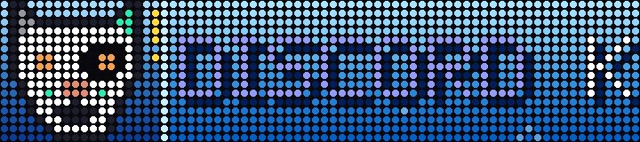
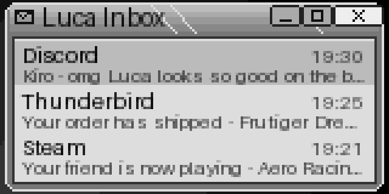
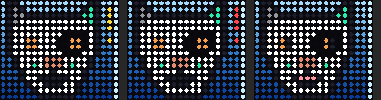

<div align="center">

# 🔔 Luca Notify Den 🐺

### *Your PC's notifications on the BUSY Bar: Luca perks up whenever something pings*





</div>

---

## ✨ What it does

When a notification pops up on your PC (a Discord ping, a Telegram message, an email, a
finished download), it shows up on the bar too:

| Screen | What you see |
| :-- | :-- |
| **Front** (72×16 RGB LEDs) | Luca perks up with wide eyes and a yellow **!** (a blinking red one for urgent notifications), then settles in to read. The **app name** (in the app's own color) and the message scroll across a glossy Aero sky. Yellow dots on his tile show how many more are waiting |
| **Back** (160×80, 16 greys) | **Luca Inbox**, a Windows 7-style window listing your latest notifications with app names and times, with the current one highlighted |
| **Notification light** | The bar's LED glows in the app's color: Discord blurple, Telegram blue, Firefox orange, and so on |

Each notification stays up for at least 7 seconds (`--show`), or long enough to scroll all
the way through, up to 30 seconds. When nothing's left, Luca steps aside and the bar goes
back to whatever it was showing.

**Your normal pop-ups keep working exactly as before.** Luca only *watches* the
notifications going by; your notification daemon (dunst, mako, KDE, GNOME…) still shows them.



## 🎮 Controls

| Press | Does |
| :-- | :-- |
| **OK** | Dismiss, and clear anything waiting |
| **Start** | Next notification |
| **Back** | Show the one before again |
| **Wheel** | Flip through recent notifications |

The buttons only do this while Luca is showing a notification. Otherwise they're the bar's.

### 🌙 Do not disturb

Turn the bar's selector to **OFF** and Luca holds new notifications quietly (the inbox title
shows how many are waiting). Switch back and he shows you what you missed (the newest 5).

Running [🌕 Luca Pack Focus](../luca-pack-focus/)? Notifications are also held during each
**focus round**, and they show up when your break starts. With [🔴 Luca On Air](../luca-on-air/),
they're held while you're **live or recording** (in case the bar is on camera).

## 🔒 Privacy and filters

The bar sits on your desk where others can see it, so:

```bash
python notify_den.py --private
```

shows only *which app* it's from ("DISCORD  NEW NOTIFICATION"), never the message.

To skip apps entirely (Spotify sends one for every song, and Luca Now Playing already shows those):

```bash
python notify_den.py --ignore spotify,steam
```

Names are matched against the app name the notification gives, without caring about upper
or lower case.

## 🤝 Plays nicely with the other apps

Running [💬 Luca Discord](../luca-discord/)? Notify Den leaves Discord's notifications to it
(so they don't show twice) and keeps showing everyone else's.

Notify Den draws at a **high priority** (70), so a notification shows over Luca Now Playing
(50) and Luca PC Stats (20), and they come back as soon as it's done. Change it with
`--priority`.

## 🚀 Run it

Linux only: it listens on D-Bus, where Linux desktops send notifications. You need Python
3.10+ with [Pillow](https://pypi.org/project/pillow/), [dbus-fast](https://pypi.org/project/dbus-fast/) and the official
[busylib](https://pypi.org/project/busylib/) for the buttons.

```bash
pip install pillow dbus-fast busylib
```

Plug in your BUSY Bar over USB, then:

```bash
python notify_den.py
```

Send yourself a test (`notify-send` comes with `libnotify`):

```bash
notify-send "Luca" "Awoo! Testing the den 🐺"
```

Or try it with made-up notifications:

```bash
python notify_den.py --demo
```

Over Wi-Fi, add `--host 192.168.1.42` (and `--token YOUR_KEY` if HTTP access is set to *key* mode).

## 🐧 Start automatically at login

Add dbus-fast to Luca's Python environment (make it first with `python -m venv ~/.venvs/luca`
if you haven't):

```bash
~/.venvs/luca/bin/pip install pillow dbus-fast busylib
```

Then install the service. Add `--host`, `--token`, `--private`, `--ignore`, `--show` or
`--priority` if you use them; they're saved into the service:

```bash
~/.venvs/luca/bin/python notify_den.py --install
```

| To… | Run |
| :-- | :-- |
| See what Luca is doing | `journalctl --user -u luca-notify-den -f` |
| Restart him (after changing the code) | `systemctl --user restart luca-notify-den` |
| Stop him for now | `systemctl --user stop luca-notify-den` |
| Stop starting at login | `~/.venvs/luca/bin/python notify_den.py --uninstall` |

If the bar is unplugged or off Wi-Fi, Luca waits quietly and shows the latest notification when it's back.

## 🎨 Make it yours

- `art.py`: `APP_COLORS` (add your apps' colors), Luca's poses in `luca()` and `tile()`, and
  the *Luca Inbox* window in `back_screen()`
- `notify_den.py`: `ALERT_SECONDS`, `MAX_SECONDS` and `MAX_WAITING`
- `python art.py` redraws the previews in `preview/`

Messages are shown in capital pixel letters. Accents are simplified, emoji are left out,
and characters the font doesn't have (like Japanese) show as `?`.

## 🔧 How it works

`watcher.py` connects to your session's D-Bus as a **monitor** and watches for `Notify`
calls to `org.freedesktop.Notifications`, the standard every Linux app uses. It only listens,
so it never answers or blocks anything. Each notification becomes a pixel-text strip and an
inbox picture that are uploaded to the bar, then scrolled by moving the strip, like the title
in Luca Now Playing. The bar code shared by all the apps lives in [`../shared/`](../shared/).

## 💖 Credits

Luca Wood portrait art by **KiroHusky**, which his pixel sprite is based on.
