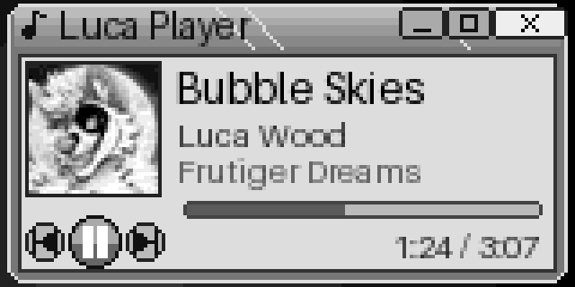

<div align="center">

# 🎵 Luca Now Playing 🐺

### *Your music on the BUSY Bar, with Luca bopping along in glossy Frutiger Aero style*




</div>

---

## ✨ What it does

| Screen | What you see |
| :-- | :-- |
| **Front** (72×16 RGB LEDs) | Luca in mint headphones on a glossy glass tile, bopping to the beat. The **title and artist** scroll across an Aero sky with drifting bubbles, and a mint **progress bar** fills up as the song plays |
| **Back** (160×80, 16 greys) | **Luca Player**, a Windows 7-style media player window with the song, artist and album, a progress bar with the time, and the classic glossy play/pause orb |

When the music is paused, the text dims and stops scrolling. When nothing's playing, Luca dozes off in his headphones.

## 🎮 Control your music from the bar

| Press | Does |
| :-- | :-- |
| **OK** | Play / pause |
| **Start** | Next song (Luca does a happy hop) |
| **Back** | Previous song |

## 💻 Where it gets the music from

| Computer | Works with | Extra setup |
| :-- | :-- | :-- |
| **macOS** | Spotify and Apple Music | None. The first time, macOS asks to let your terminal control the app; click **OK** |
| **Windows** | Anything in the Windows media overlay: Spotify, browsers, Media Player… | `pip install winsdk` |
| **Linux** | Any MPRIS player (Spotify, VLC, browsers…) | Install `playerctl` from your package manager |

## 🚀 Run it

You need Python 3.10+, [Pillow](https://pypi.org/project/pillow/) to draw the screens, and the
official [busylib](https://pypi.org/project/busylib/) for the buttons.

```bash
pip install pillow busylib
```

Plug in your BUSY Bar over USB, start some music, then:

```bash
python now_playing.py
```

Over Wi-Fi, use the bar's IP address (and its API key, if HTTP access is set to *key* mode):

```bash
python now_playing.py --host 192.168.1.42 --token YOUR_KEY
```

No music handy? Try it with a pretend playlist:

```bash
python now_playing.py --demo
```

Press **Ctrl+C** to stop. Luca takes his headphones off and the screens are cleared. 🌙

## 🎨 Make it yours

- `art.py` has everything you see: `LUCA` (the pixel Luca with headphones), `PALETTE`, the
  5×7 pixel font in `_FONT_SRC`, the bubbles and the *Luca Player* window in `back_screen()`
- `BUTTON_ACTIONS` in `now_playing.py`: which button does what
- `--fps`: how fast the title scrolls (default 10)
- `python art.py` redraws the previews in `preview/`

Song titles are shown in capital pixel letters. Accents are simplified (*Café* shows as
*CAFE*), and characters the font doesn't have (like Japanese) show as `?`.

## 🔧 How it works

`media.py` asks your computer what's playing about once a second. When the song or the
play state changes, `now_playing.py` draws a new title strip and back screen with Pillow and
uploads them through the BUSY Bar's local HTTP API (`/api/assets/upload`). About ten times a
second it redraws the screen with `/api/display/draw`: the sky, the title strip slid
sideways to scroll it, Luca's tile on top, and the progress bars and time as live
rectangles and text. Button presses come from the bar's status stream (`/api/status/ws`,
via `busylib`).

## 💖 Credits

Luca Wood portrait art by **KiroHusky**.
