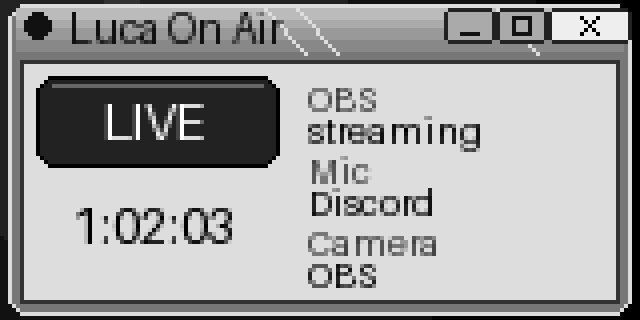
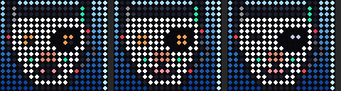

<div align="center">

# 🔴 Luca On Air 🐺

### *An ON AIR sign for the BUSY Bar that lights up by itself when you're live, recording or in a call*




</div>

---

## ✨ What it does

The BUSY Bar is all about letting the people around you know you're busy. Luca On Air turns
it into an **ON AIR sign** that switches itself on and off:

| Sign | When | Light |
| :-- | :-- | :-- |
| 🔴 **ON AIR / LIVE 12:34** | OBS is **streaming** (Twitch, YouTube, anywhere) | red |
| ⏺️ **● 12:34** (or **PAUSED**) | OBS is **recording** | red |
| 🎧 **IN CALL / DISCORD** | Discord, Zoom, Teams, Slack, Signal, Telegram, Mumble, a browser call… is **using your mic** | green |
| 📷 **CAM ON / ZOOM** | An app has your **webcam** open | violet |
| *(nothing)* | You're off air, so the bar shows your other apps | |

The signs are glossy Aero panels that gently glow. Luca wears a **gaming headset**: his mouth
moves on calls, and his mic light flickers when you're live.

The **back screen** is **Luca On Air**, a Windows 7-style window with a big status badge, how
long you've been live or recording, and what OBS, your mic and your camera are each doing.



### 🤫 Plays nicely with Notify Den

While you're **live or recording**, [🔔 Luca Notify Den](../luca-notify-den/) holds your
notifications (in case the bar is on camera) and shows them once you're done.

## 🎮 Controls

| Press | Does |
| :-- | :-- |
| **Start** / **Back** / **wheel** | Next / previous page |
| **OK** | Hide the sign until something changes |

## 🔍 How it knows (all on your PC, no accounts)

| Source | How |
| :-- | :-- |
| **OBS** live / recording | OBS Studio's built-in WebSocket (OBS 28 and newer). Turn it on in OBS: **Tools → WebSocket Server Settings → Enable WebSocket server**. If it has a password, give it with `--obs-password` |
| **Calls** | Which apps are recording from a real microphone right now, via `pactl` (PipeWire or PulseAudio). Paused streams, speaker monitors (like the cava visualizer) and OBS itself don't count |
| **Camera** | Which of your apps have a `/dev/video*` webcam open |

OBS can be closed and opened whenever you like: Luca reconnects by himself.

## 🚀 Run it

You need Linux, Python 3.10+ with [Pillow](https://pypi.org/project/pillow/), and the official
[busylib](https://pypi.org/project/busylib/) (which also brings the WebSocket library for OBS).

```bash
pip install pillow busylib
```

On Arch, `pactl` comes with `libpulse` (installed with PipeWire's `pipewire-pulse`):

```bash
sudo pacman -S libpulse
```

```bash
python on_air.py --obs-password YOUR_OBS_PASSWORD
```

See every sign without going live:

```bash
python on_air.py --demo
```

| Option | Does |
| :-- | :-- |
| `--obs-password` | OBS WebSocket password (or set `OBS_PASSWORD`) |
| `--obs-host` | Where OBS is (default `localhost:4455`) |
| `--no-obs` / `--no-mic` / `--no-camera` | Leave one out |
| `--call-apps jami,linphone` | More apps whose mic use means a call |
| `--host` / `--token` | The bar's address over Wi-Fi, and its API key if HTTP access is set to *key* mode |
| `--priority` | Draw priority 1–100 (default 65) |

## 🐧 Start automatically at login

```bash
~/.venvs/luca/bin/pip install pillow busylib
```

```bash
~/.venvs/luca/bin/python on_air.py --obs-password YOUR_OBS_PASSWORD --install
```

Your OBS password is saved into the service file, which only you can read (like the bar's
API key).

| To… | Run |
| :-- | :-- |
| See what Luca is doing | `journalctl --user -u luca-on-air -f` |
| Restart him (after changing the code) | `systemctl --user restart luca-on-air` |
| Stop starting at login | `~/.venvs/luca/bin/python on_air.py --uninstall` |

## 🤝 With the other apps

| App | Priority |
| :-- | :-- |
| 🔔 Notify Den | 70 (but it holds notifications while you're live or recording) |
| 🔴 **On Air** | **65** |
| 🌕 Pack Focus | 60 |
| 🎵 Now Playing | 50 |
| 📈 PC Stats | 20 |
| ⛅ Weather Den | 15 |
| 🕰️ Aero Clock | 10 |

When you're on air, the sign takes the bar. When you're not, it steps aside completely.

## 🎨 Make it yours

- `art.py`: the sign colors in `SIGN_COLORS`, the light colors in `LED`, Luca's headset in
  `LUCA`, and the *Luca On Air* window in `back_screen()`
- `sources.py`: `CALL_APPS` (which apps count as a call) and `IGNORE_MIC`
- `python art.py` redraws the previews in `preview/`

## 🔧 How it works

`sources.py` keeps a connection to OBS (obs-websocket 5, with password authentication) and
listens for stream and record events. Every 2 seconds it asks `pactl` which apps are
recording from a microphone, and looks through your own processes' open files for a webcam.
The signs, Luca, the words and the digits are uploaded to the bar once, so the time on air
ticks without new uploads. While you're live or recording it keeps
`$XDG_RUNTIME_DIR/luca-onair.json` fresh, which is how Notify Den knows to stay quiet. The bar
code shared by all the apps lives in [`../shared/`](../shared/).

## 💖 Credits

Luca Wood portrait art by **KiroHusky**, which his pixel sprite is based on.
