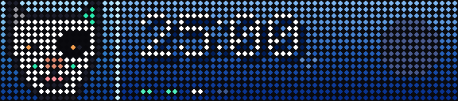
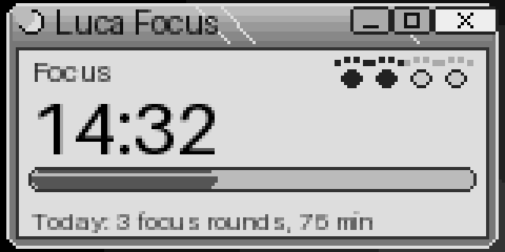

<div align="center">

# 🌕 Luca Pack Focus 🐺

### *A Pomodoro-style focus timer for the BUSY Bar: watch the moon fill up, then Luca howls*





</div>

---

## ✨ What it does

Focus for **25 minutes** while a moon waxes from new to full beside the countdown. When
it's full, Luca throws his head back and howls **AWOO!** and the bar's light glows gold. Then
take a **5-minute break** under a sunset sky. After every **4th** round you get a **15-minute
long break** under the stars.

| Screen | What you see |
| :-- | :-- |
| **Front** (72×16 RGB LEDs) | The countdown, the waxing moon, and a paw marker for each round of the cycle (mint when done, blinking for the current one). The sky changes with the part you're in: deep Aero blue to focus, a sunset for a short break, a starry night for the long one |
| **Back** (160×80, 16 greys) | **Luca Focus**, a Windows 7-style timer window: a big countdown, paw prints for the rounds, an Aero progress bar, and **today's total** (focus rounds and minutes, kept across restarts) |

| Luca is… | When |
| :-- | :-- |
| 😤 **Focused** (determined eyes) | During a focus round |
| 😊 **Resting** (happy eyes, bouncing) | During a break |
| 🐺 **Howling** | When a part ends |
| ⏸️ **Paused** | While paused (the time blinks) |
| 👀 **Waiting** (blinking) | Ready for you to press Start; between parts the strip says **START?** |

## 🎮 Controls

| Press | Does |
| :-- | :-- |
| **Start** | Start / pause |
| **OK** | Skip to the next part |
| **Back** | Start this part over |
| **Wheel** | Add or take away a minute (before starting, or while paused) |

## 🤫 Quiet while you focus

If you run [🔔 Luca Notify Den](../luca-notify-den/), it **holds your notifications during
every focus round** and shows them when the break starts. Nothing to set up: the apps
notice each other.

## 🚀 Run it

You need Python 3.10+ with [Pillow](https://pypi.org/project/pillow/) and the official
[busylib](https://pypi.org/project/busylib/) for the buttons.

```bash
pip install pillow busylib
```

Plug in your BUSY Bar over USB, then:

```bash
python pack_focus.py
```

Luca appears straight away. Press **Start** to begin.

| Option | Does |
| :-- | :-- |
| `--focus 50m` | Focus length (default `25m`) |
| `--break 10m` | Short break (default `5m`) |
| `--long 30m` | Long break (default `15m`) |
| `--rounds 3` | Focus rounds before a long break (default 4) |
| `--auto` | Roll into the next part by itself instead of waiting for Start |
| `--host` / `--token` | The bar's address over Wi-Fi, and its API key if HTTP access is set to *key* mode |

Times take minutes (`25`, `25m`, `1.5`) or seconds (`90s`).

## 🐧 Start automatically at login (Linux)

```bash
~/.venvs/luca/bin/pip install pillow busylib
```

```bash
~/.venvs/luca/bin/python pack_focus.py --install
```

Add your own `--focus`, `--break`, `--long`, `--rounds` or `--auto`; they're saved into the service.

Started at login, Luca **waits out of sight** so he doesn't take over the bar all day.
When you want to focus:

1. Move the bar's selector to **CUSTOM**. Luca's timer comes up and **stays** there: the
   clock, weather and other apps don't take turns over him while the selector is on CUSTOM.
2. Press **Start**.

Move the selector off CUSTOM and he steps aside again. The bar only says where the selector
is when it moves, so if it was already on CUSTOM when Luca started, flick it away and back.

Once the timer is running he stays on the bar until the part is done, wherever the selector
is. If you leave him waiting between parts or paused, he steps aside after 10 minutes.

| To… | Run |
| :-- | :-- |
| See what Luca is doing | `journalctl --user -u luca-pack-focus -f` |
| Restart him (after changing the code) | `systemctl --user restart luca-pack-focus` |
| Stop starting at login | `~/.venvs/luca/bin/python pack_focus.py --uninstall` |

## 🤝 With the other apps

| App | Priority |
| :-- | :-- |
| 🔔 Notify Den | 70 |
| 🌕 **Pack Focus** | **60** |
| 🎵 Now Playing | 50 |
| 📈 PC Stats | 20 |
| ⛅ Weather Den | 15 |

A running timer shows over your music, stats and weather. Only notifications go over it,
and Notify Den holds those until your break anyway. The buttons always go to whichever
app is on top.

## 🎨 Make it yours

- `art.py`: the skies in `sky()`, the moon in `moon()`, Luca's poses in `luca()`, and the
  *Luca Focus* window in `back_screen()`
- `pack_focus.py`: `HOWL_SECONDS`, `WAIT_TIMEOUT` and `SUMMON` (the selector position that
  brings him up)
- `python art.py` redraws the previews in `preview/`

## 🔧 How it works

Everything on the front strip (skies, all 17 moon phases, Luca's poses, digits and words)
is uploaded **once**. Each frame just places the pieces, so the countdown can tick every
second without uploading anything. Only the back screen is redrawn, once a second. While a
focus round runs, the app keeps `$XDG_RUNTIME_DIR/luca-focus.json` fresh, which is how
Notify Den knows to stay quiet. Today's totals live in `~/.cache/luca-pack-focus.json`. The
bar code shared by all the apps lives in [`../shared/`](../shared/).

## 💖 Credits

Luca Wood portrait art by **KiroHusky**, which his pixel sprite is based on.
