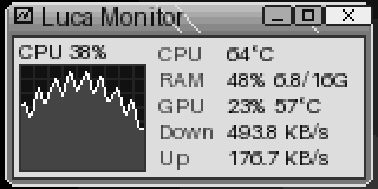

<div align="center">

# 📈 Luca PC Stats 🐺

### *Your PC's vitals on the BUSY Bar, in glossy Frutiger Aero style, with Luca feeling the heat*




</div>

---

## ✨ What it does

| Screen | What you see |
| :-- | :-- |
| **Front** (72×16 RGB LEDs) | One stat at a time (**CPU**, **RAM**, **GPU**, **TEMP**) with its number and a glossy Aero gauge that goes from mint to yellow to red as it fills. The pages flip every 5 seconds, and little dots show which page you're on |
| **Back** (160×80, 16 greys) | **Luca Monitor**, a Windows 7 Task Manager-style window: a CPU usage history graph plus CPU and GPU temperature, RAM use, GPU load, and network down/up speeds |

### 🌡️ Luca feels the heat


| Hottest of CPU / GPU | Luca |
| :-- | :-- |
| under 55 °C | 😊 **Cool**: happy eyes |
| 55–70 °C | 🙂 **OK** |
| 70–82 °C | 😅 **Warm**: a sweat drop |
| 82 °C and up | 🥵 **Hot**: flushed cheeks, tongue out |

He also bops faster when the CPU is working hard (over 50%).

## 🎮 Controls

| Press | Does |
| :-- | :-- |
| **Start** / **Back** | Next / previous page |
| **Wheel** | Flip through the pages |
| **OK** | Pin the current page so it stops flipping (the page dot turns mint). Press again to unpin |

After you flip pages by hand, it waits 20 seconds before flipping on its own again.

## 💻 What it can read

| Stat | Where it comes from |
| :-- | :-- |
| CPU, RAM, network | [psutil](https://pypi.org/project/psutil/), on any computer |
| CPU temperature | psutil's sensors on Linux: AMD (`k10temp`, `zenpower`) and Intel (`coretemp`) |
| NVIDIA GPU | `nvidia-smi` (comes with the NVIDIA driver) |
| AMD GPU | the `amdgpu` driver's files in `/sys`. On a desktop with integrated graphics too, it shows the busier one |

Anything your PC can't report shows as `--`, and pages with nothing to show (no GPU, no
temperature sensors) are skipped.

## 🤝 Plays nicely with Luca Now Playing

PC Stats draws at a **low priority** (20). Luca Now Playing uses the normal priority (50), so
when music starts, Now Playing takes the bar, and when it steps aside, your stats come back.
Change it with `--priority` (1–100).

## 🚀 Run it

You need Python 3.10+ with [Pillow](https://pypi.org/project/pillow/), [psutil](https://pypi.org/project/psutil/) and the
official [busylib](https://pypi.org/project/busylib/) for the buttons.

```bash
pip install pillow psutil busylib
```

Plug in your BUSY Bar over USB, then:

```bash
python pc_stats.py
```

Over Wi-Fi, use the bar's IP address (and its API key, if HTTP access is set to *key* mode):

```bash
python pc_stats.py --host 192.168.1.42 --token YOUR_KEY
```

Try it with made-up numbers (they drift from cool to hot so you can see all of Luca's moods):

```bash
python pc_stats.py --demo
```

Prefer Fahrenheit? Add `--fahrenheit`.

## 🐧 Start automatically at login (Linux)

If you set up Luca Now Playing, you already have a Python environment for Luca. Add psutil to it:

```bash
~/.venvs/luca/bin/pip install pillow psutil busylib
```

(New here? Make one first with `python -m venv ~/.venvs/luca`.)

Then install the service. Add `--host`, `--token`, `--priority` or `--fahrenheit` if you use
them; they're saved into the service:

```bash
~/.venvs/luca/bin/python pc_stats.py --install
```

| To… | Run |
| :-- | :-- |
| See what Luca is doing | `journalctl --user -u luca-pc-stats -f` |
| Restart him (after changing the code) | `systemctl --user restart luca-pc-stats` |
| Stop him for now | `systemctl --user stop luca-pc-stats` |
| Stop starting at login | `~/.venvs/luca/bin/python pc_stats.py --uninstall` |

If the bar is unplugged or off Wi-Fi, Luca waits quietly and comes back when it does.

> 🏠 Running more than one always-on app (PC Stats, Weather Den, Aero Clock)? Start
> [Luca's Den](../luca-den/) and they'll take turns, a minute each.

## 🎨 Make it yours

- `art.py`: Luca's moods in `luca()`, the gauge colors in `gauge_color()`, and the *Luca
  Monitor* window in `back_screen()`
- `pc_stats.py`: the temperature thresholds in `Front.mood()`, `PAGE_SECONDS` and `MANUAL_HOLD`
- `python art.py` redraws the previews in `preview/`

## 🔧 How it works

`stats.py` reads the PC once a second. To keep things light, every image on the front strip
(the sky, Luca's moods, the page names, and each digit and symbol) is uploaded **once**.
After that, each frame just tells the bar which pieces to place where. The gauges are live
rectangles. Only the back screen is redrawn and uploaded, every 2 seconds, for the graph.
The bar code shared by all the apps lives in [`../shared/`](../shared/).

## 💖 Credits

Luca Wood portrait art by **KiroHusky**, which his pixel sprite is based on.
