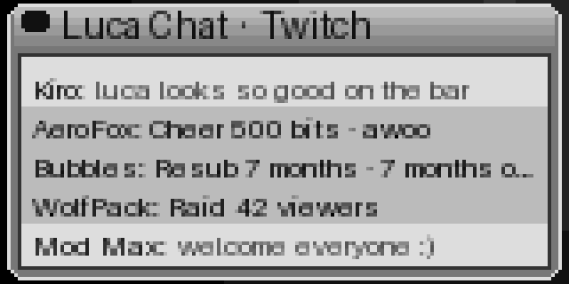

<div align="center">

# 💜 Luca Stream Chat 🐺

### *Your Twitch or YouTube live chat on the BUSY Bar, with sparkling alerts for subs and raids*




</div>

---

## ✨ What it does

| What happens | On the bar |
| :-- | :-- |
| 💬 **Someone chats** | Their message scrolls across a glossy **Twitch-purple** (or **YouTube-red**) panel, their **name in their own chat color**, while streamer Luca reads along in his headset |
| ✨ **An alert** | A **sparkling gold** panel with confetti, a happy Luca hop, and the bar's light glows gold: **NEW SUB!**, **RESUB!** (with months), **GIFT SUBS!** (how many), **RAID!** (how many viewers), **CHEER!** (bits), **SUPER CHAT!** (the amount), **NEW MEMBER!**, and **FIRST CHAT!** for first-time chatters |
| 🤫 **Chat goes quiet** | Luca steps aside, and your [🔴 ON AIR](../luca-on-air/) sign (or whatever else) comes back |

The **back screen** is **Luca Chat**, a Windows 7-style chat log of the latest lines, with alerts
highlighted.

Busy chat? Alerts always go first. When more is waiting, chat moves along quickly, and only
the newest few messages are kept, so the bar never falls behind. Links show as `[link]`, and
the usual bots (Nightbot, StreamElements, Streamlabs…) are skipped.

## 🎮 Controls

| Press | Does |
| :-- | :-- |
| **OK** | Hide chat for 5 minutes (alerts still show) |
| **Start** / **wheel** | Skip to the next message |

## 🔑 What you need

| Platform | Setup |
| :-- | :-- |
| **Twitch** | **Nothing!** Luca reads chat anonymously (read-only), so there's no login and no key. Just give your channel name |
| **YouTube** | A free **YouTube Data API key**: in the [Google Cloud Console](https://console.cloud.google.com/apis/library/youtube.googleapis.com), enable *YouTube Data API v3*, then go to **Credentials → Create credentials → API key**. Plus your live stream's **video ID** (the part after `watch?v=`) |

> YouTube gives each key a daily quota. Luca checks chat only as often as YouTube asks
> (usually every few seconds), which is fine for normal streams. If YouTube refuses (bad key,
> quota used up), Luca says so and waits a couple of minutes before trying again.

## 🚀 Run it

You need Python 3.10+ with [Pillow](https://pypi.org/project/pillow/) and the official
[busylib](https://pypi.org/project/busylib/) for the buttons.

```bash
pip install pillow busylib
```

```bash
python stream_chat.py --twitch yourchannel
```

```bash
python stream_chat.py --youtube VIDEO_ID --youtube-key YOUR_API_KEY
```

You can use both at once. Or try it with pretend chat, subs and a raid:

```bash
python stream_chat.py --demo
```

| Option | Does |
| :-- | :-- |
| `--alerts-only` | Only subs, raids, cheers and so on, no chat |
| `--only-live` | Only show while [🔴 Luca On Air](../luca-on-air/) says you're live or recording |
| `--show-links` | Show links instead of `[link]` |
| `--host` / `--token` | The bar's address over Wi-Fi, and its API key if HTTP access is set to *key* mode |
| `--priority-chat` / `--priority-alert` | Draw priorities (defaults 66 and 68) |

## 🐧 Start automatically at login

```bash
~/.venvs/luca/bin/python stream_chat.py --twitch yourchannel --install
```

Your YouTube API key (if you use one) is saved into the service file, which only you can read.
For YouTube the video ID changes each stream, so you'll want to re-run `--install` (or just run
it by hand) when you go live.

## 🤝 With the other apps

Chat (66) and alerts (68) show just **above the ON AIR sign** (65), so while you're live the bar
shows chat as it comes in and goes back to ON AIR when it's quiet. Notifications (70) are held
by Notify Den while you're live anyway.

## 🎨 Make it yours

- `art.py`: the panel colors in `PANELS`, the alert words in `HEADLINES`, the role colors, and
  the *Luca Chat* window
- `stream_chat.py`: the timings (`CHAT_SECONDS`, `ALERT_SECONDS`, `BUSY_CHAT`…) and `SNOOZE_SECONDS`
- `chat_sources.py`: `IGNORE_BOTS`
- `python art.py` redraws the previews in `preview/`

## 🔧 How it works

`chat_sources.py` joins Twitch chat over its IRC interface (TLS, anonymous `justinfan` login,
with tags for names, colors, badges, bits and USERNOTICE alerts). It polls YouTube's
`liveChat/messages` at the pace YouTube asks, skipping the backlog from before Luca started.
Each line becomes one uploaded text strip, scrolled by moving it.

## 💖 Credits

Luca Wood portrait art by **KiroHusky**, which his pixel sprite is based on. Twitch and YouTube
are trademarks of their owners; this is an unofficial fan-made app.
