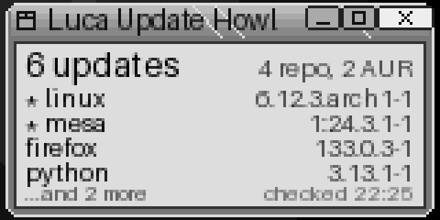

<div align="center">

# 📦 Luca Update Howl 🐺

### *Your Arch updates on the BUSY Bar: Luca howls for a new kernel and wears a hard hat when it's time to reboot*





</div>

---

## ✨ What it does

Every 30 minutes Luca checks what's waiting:

| Where | How | Notes |
| :-- | :-- | :-- |
| Official repos | `checkupdates` (pacman-contrib) | Uses a fresh copy of the package lists in a temporary folder: your real database is never touched, no root needed |
| The AUR | `paru -Qua` | Skipped with `--no-aur` |
| Reboot needed | Your running kernel's modules are gone | That's what happens after a kernel update until you reboot |

| Screen | What you see |
| :-- | :-- |
| **Front** (72×16 RGB LEDs) | A glossy sign that's **Aero blue** while updates wait, **amber** when it's time to reboot and **minty teal** when you're fresh. The pages take turns: **6 UPDATES**, **AUR 2**, the big ones (kernel, drivers, systemd, mesa…), **REBOOT** |
| **Back** (160×80, 16 greys) | A Windows 7-style **Luca Update Howl** window: how many (repo / AUR), the first few packages with their new versions (★ for the big ones), and when it last checked |

| When | Luca |
| :-- | :-- |
| New updates arrive | Pops up for 20 seconds, LED glows blue |
| One of them is a kernel | 🐺 **Howls** (awoo!) |
| You need to reboot | ⛑️ Puts on a **hard hat**, LED glows amber |
| Everything's up to date | 😊 Happy, and stays out of the way |

Right after you update (`paru`), he notices the package database changed and checks
again, so the count drops by itself. **Nothing is ever installed for you**: updating is
still up to you.

### 🏠 With Luca's Den

While updates are waiting, Luca also takes his **turn** in [Luca's Den](../luca-den/)
rotation with the clock, weather and stats, with an UPDATES switch card. Once you're
fresh, he drops out of the rotation by himself. Without the Den, he only pops up when
there's news.

## 🎮 Controls

| Press | Does |
| :-- | :-- |
| **Start** / **Back** / **Wheel** | Next / previous page |
| **OK** | Hide until something changes (new updates, or a reboot needed) |

## 🚀 Run it

You need `pacman-contrib` (for `checkupdates`), and `paru` for the AUR, plus Python 3.10+
with [Pillow](https://pypi.org/project/pillow/) and the official
[busylib](https://pypi.org/project/busylib/) for the buttons.

```bash
sudo pacman -S --needed pacman-contrib
```

```bash
pip install pillow busylib
```

```bash
python update_howl.py
```

See it all (updates with a kernel, then a reboot, then all fresh) without waiting:

```bash
python update_howl.py --demo
```

Check what Luca sees right now, in the terminal:

```bash
python updates.py
```

| Option | Does |
| :-- | :-- |
| `--every 60m` | How often to check (default 30m, at least 5m: it goes online) |
| `--no-aur` | Only the official repos |
| `--host` / `--token` | The bar's address over Wi-Fi, and its API key if HTTP access is set to *key* mode |
| `--priority` | Draw priority on his Den turns (default 18; pop-ups go 12 higher, so 30) |

## 🐧 Start automatically at login (Linux)

From the repo's main folder, `python install.py updates` sets it up (and offers to install
`pacman-contrib`). Or by hand, using Luca's Python environment:

```bash
~/.venvs/luca/bin/pip install pillow busylib
```

```bash
~/.venvs/luca/bin/python update_howl.py --install
```

| To… | Run |
| :-- | :-- |
| See what Luca is doing | `journalctl --user -u luca-update-howl -f` |
| Restart him (after changing the code) | `systemctl --user restart luca-update-howl` |
| Stop starting at login | `~/.venvs/luca/bin/python update_howl.py --uninstall` |

## 🎨 Make it yours

- `updates.py`: which packages count as big ones (★) in `BIG`
- `art.py`: the sign colors in `MOODS`, Luca and his hard hat in `LUCA` / `HARDHAT`, and the
  window in `back_screen()`
- `update_howl.py`: `POP_SECONDS` and `PAGE_SECONDS`
- `python art.py` redraws the previews in `preview/`

## 💖 Credits

Luca Wood portrait art by **KiroHusky**, which his pixel sprite is based on.
