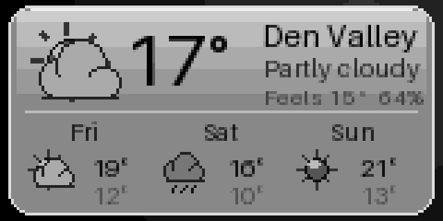

<div align="center">

# ⛅ Luca Weather Den 🐺

### *Live local weather on the BUSY Bar in glossy Frutiger Aero style, with Luca dressed for it*




</div>

---

## ✨ What it does

| Screen | What you see |
| :-- | :-- |
| **Front** (72×16 RGB LEDs) | The sky outside, animated: a glossy sun, stars and the moon, drifting clouds, rolling fog, slanting rain, falling snow or a thunderstorm with lightning. Beside Luca, the pages take turns every 5 seconds: **temperature and conditions**, today's **high and low**, the **chance of rain**, how it **feels**, and your **city** |
| **Back** (160×80, 16 greys) | A **Windows 7 desktop gadget**-style weather card: a big temperature, the city, the conditions, how it feels, humidity, and a three-day forecast with little icons |

### 👕 Luca dresses for the weather


| Weather | Luca |
| :-- | :-- |
| Sunny or partly cloudy, 15 °C and up | 😎 **Shades** |
| Sunny and 28 °C and up | 🥵 **Shades**, a sweat drop and his tongue out |
| Rain, drizzle or storms | ☂️ A mint **umbrella** |
| Snow, or 3 °C and below | 🧣 A cozy red **scarf** |
| Night | 😴 **Dozing** (he breathes slowly) |
| Anything else | 🐺 Just Luca |

## 🎮 Controls

| Press | Does |
| :-- | :-- |
| **Start** / **Back** | Next / previous page |
| **Wheel** | Flip through the pages |
| **OK** | Check the weather again right now |

After you flip pages by hand, it waits 20 seconds before flipping on its own again.

## 🚀 Run it

You need Python 3.10+ with [Pillow](https://pypi.org/project/pillow/) and the official
[busylib](https://pypi.org/project/busylib/) for the buttons. The weather comes from
[Open-Meteo](https://open-meteo.com): free, no account or API key needed.

```bash
pip install pillow busylib
```

Tell Luca where you are:

```bash
python weather_den.py --city "Berlin"
```

If several places share a name, add the state or country:

```bash
python weather_den.py --city "Portland, Oregon" --fahrenheit
```

Or use exact coordinates (nothing is looked up by name):

```bash
python weather_den.py --lat 52.52 --lon 13.41 --name "Home"
```

Try every kind of weather without going outside:

```bash
python weather_den.py --demo
```

| Option | Does |
| :-- | :-- |
| `--fahrenheit` | °F and mph instead of °C and km/h |
| `--refresh 15` | Check every 15 minutes (default 10; Open-Meteo updates every 15) |
| `--host` / `--token` | The bar's address over Wi-Fi, and its API key if HTTP access is set to *key* mode |
| `--priority` | Draw priority 1–100 (default 15) |

The place you look up is remembered, along with the last reading, in
`~/.cache/luca-weather-den.json`. So if your PC starts before the internet is up, Luca
shows the last weather straight away and updates when he can. After 45 minutes without
an update, the gadget says *offline*.

## 🐧 Start automatically at login (Linux)

Using Luca's Python environment (make it first with `python -m venv ~/.venvs/luca` if you haven't):

```bash
~/.venvs/luca/bin/pip install pillow busylib
```

```bash
~/.venvs/luca/bin/python weather_den.py --city "Berlin" --install
```

Your city and any other options (`--fahrenheit`, `--refresh`, `--host`, `--token`,
`--priority`) are saved into the service.

| To… | Run |
| :-- | :-- |
| See what Luca is doing | `journalctl --user -u luca-weather-den -f` |
| Restart him (after changing the code) | `systemctl --user restart luca-weather-den` |
| Stop him for now | `systemctl --user stop luca-weather-den` |
| Stop starting at login | `~/.venvs/luca/bin/python weather_den.py --uninstall` |

## 🤝 With the other apps

| App | Priority |
| :-- | :-- |
| 🔔 Notify Den | 70 |
| 🎵 Now Playing | 50 |
| 📈 PC Stats | 20 |
| ⛅ **Weather Den** | **15** |

The bar should show the highest one with something to show, so notifications and music go
over the weather. Weather Den and PC Stats are both "always on", so if you run both, PC
Stats wins. Give Weather Den `--priority 25` if you'd rather see the weather.

> 🏠 Running more than one always-on app (PC Stats, Weather Den, Aero Clock)? Start
> [Luca's Den](../luca-den/) and they'll take turns, a minute each.

## 🎨 Make it yours

- `art.py`: the skies in `scene()`, Luca's outfits in `luca()`, which outfit when in
  `outfit()`, the words in `WORDS`, and the gadget in `back_screen()`
- `weather_den.py`: `PAGE_SECONDS`, `MANUAL_HOLD` and `STALE_AFTER`
- `python art.py` redraws the previews in `preview/`

## 🔧 How it works

`weather.py` asks Open-Meteo for the current weather and a four-day forecast, by default
every 10 minutes. Luca's outfits are uploaded to the bar once. The animated sky (12
frames) is uploaded only when the kind of weather changes, and the pages and the gadget
when a new reading arrives. Each frame just tells the bar which pictures to place where.
The bar code shared by all the apps lives in [`../shared/`](../shared/).

## 💖 Credits

Weather data by [Open-Meteo.com](https://open-meteo.com/) (CC BY 4.0). Luca Wood portrait
art by **KiroHusky**, which his pixel sprite is based on.
