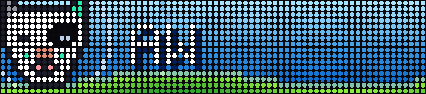
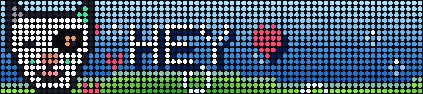
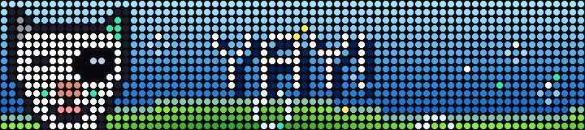
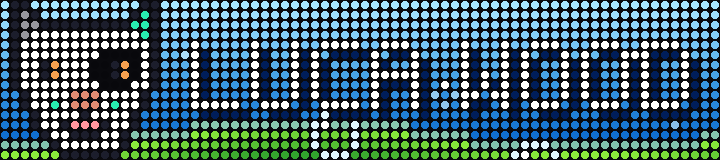
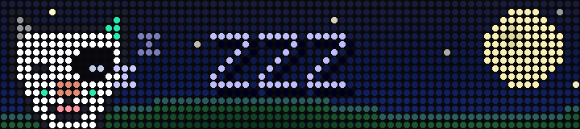

<div align="center">

# 🐺 Luca Wood Aero 🫧

### *My fursona, Luca Wood, living on the BUSY Bar in glossy Frutiger Aero / Windows 7 style*


</div>

---

## ✨ What it does

| Screen | What you see |
| :-- | :-- |
| **Front** (72×16 RGB LEDs) | A shiny Aero sky with a glass highlight, a rolling green hill, bubbles drifting upward, a bouncing pixel Luca 🐺 and **LUCA WOOD** in glossy letters |
| **Back** (160×80, 16 greys) | An *"About Luca"* Windows 7 window with a glass title bar, light streaks, min/max/close buttons, Luca's portrait, a little bio and an Aero progress bar |

## 🎮 Luca reacts to you

| Press | Luca… | Front strip |
| :-- | :-- | :-- |
| **OK** | throws his head back and howls |  |
| **Back** | winks and sends hearts |  |
| **Start** | jumps for joy while sparkles pop |  |
| **Wheel** | looks left or right |  |
| *nothing for a minute* | falls asleep under the moon (any press wakes him with a hello) |  |

The status line in the back screen's window changes too (*chilling*, *AWOOO!*, *partying*, *sleeping*…).

## 🚀 Run it

You need Python 3.10+, [Pillow](https://pypi.org/project/pillow/) for making the artwork, and the
official [busylib](https://pypi.org/project/busylib/) for listening to the buttons.

```bash
pip install pillow busylib
```

```bash
python render.py
```

Plug in your BUSY Bar over USB, then:

```bash
python luca_aero.py
```

Over Wi-Fi, use the bar's IP address (and its API key, if HTTP access is set to *key* mode):

```bash
python luca_aero.py --host 192.168.1.42 --token YOUR_KEY
```

Press **Ctrl+C** to stop. Luca says goodnight and the screens are cleared. 🌙

## 🎨 Make it yours

Everything is in `render.py`:

- `LUCA_ICON`: the 16×16 pixel Luca, one letter per pixel colour (see `PALETTE`)
- `BUBBLES`: bubble positions, speeds and sizes
- `back_frame()`: the look of the Aero window
- `MOODS` / `STATUS`: add your own moods and status lines
- `BUTTON_MOODS` in `luca_aero.py`: which button does what
- `--fps`: animation speed (`python luca_aero.py --fps 10`)
- `--sleep-after`: seconds before Luca naps (`python luca_aero.py --sleep-after 300`)

Re-run `python render.py` after any change.

## 🔧 How it works

`render.py` draws every mood's frames with Pillow into `build/`, plus a
`manifest.json` listing them. `luca_aero.py` uploads them through the BUSY Bar's
local HTTP API (`/api/assets/upload`), loops `/api/display/draw` to play the
current mood, and listens to the bar's live status stream (`/api/status/ws`,
via `busylib`) for button presses and wheel turns. Without `busylib` the app
still runs; Luca just won't react.

## 💖 Credits

Luca Wood portrait art by **KiroHusky**.
