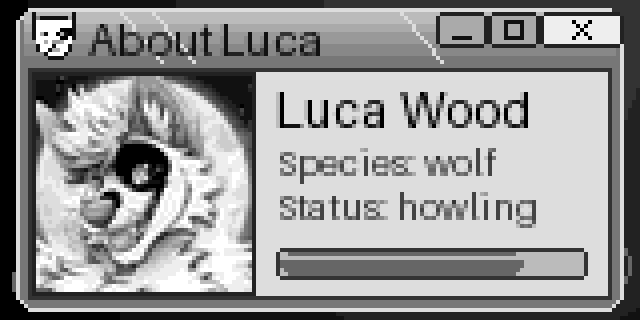

<div align="center">

# 🐺 Luca Wood Aero 🫧

### *My fursona, Luca Wood, living on the BUSY Bar in glossy Frutiger Aero / Windows 7 style*




</div>

---

## ✨ What it does

| Screen | What you see |
| :-- | :-- |
| **Front** (72×16 RGB LEDs) | A shiny Aero sky with a glass highlight, a rolling green hill, bubbles drifting upward, a bouncing pixel Luca 🐺 and **LUCA WOOD** in glossy letters |
| **Back** (160×80, 16 greys) | An *"About Luca"* Windows 7 window with a glass title bar, light streaks, min/max/close buttons, Luca's portrait, a little bio and an Aero progress bar |

## 🚀 Run it

You need Python 3.10+ and [Pillow](https://pypi.org/project/pillow/) (Pillow is only for making the artwork).

```bash
pip install pillow
```

```bash
python render.py
```

Plug in your BUSY Bar over USB, then:

```bash
python luca_aero.py
```

Over Wi-Fi, use the bar's IP address (and its API key, if HTTP access is set to *key* mode):

```bash
python luca_aero.py --host 192.168.1.42 --token YOUR_KEY
```

Press **Ctrl+C** to stop. Luca says goodnight and the screens are cleared. 🌙

## 🎨 Make it yours

Everything is in `render.py`:

- `LUCA_ICON`: the 16×16 pixel Luca, one letter per pixel colour (see `PALETTE`)
- `BUBBLES`: bubble positions, speeds and sizes
- `back_frame()`: the window text, like `Status: howling`
- `--fps`: how fast the bubbles float (`python luca_aero.py --fps 10`)

Re-run `python render.py` after any change.

## 🔧 How it works

`render.py` draws the frames with Pillow into `build/`. `luca_aero.py` uploads
them through the BUSY Bar's local HTTP API (`/api/assets/upload`) and then
loops `/api/display/draw` to flip through the front frames. It uses only the
standard library.

## 💖 Credits

Luca Wood portrait art by **KiroHusky**.
